# Hệ Thống Quản Lý Thư Viện (Library Management System) Theo Nguyên Lý SOLID

## 1. Mô tả bài toán và Chức năng nghiệp vụ

Hệ thống quản lý thư viện cung cấp các dịch vụ cốt lõi:

1. **Quản lý Sách**:
   - Thêm sách mới vào kho dữ liệu thư viện (kiểm tra trùng mã ISBN).
   - Kiểm tra trạng thái khả dụng của sách (`AVAILABLE`, `BORROWED`, `ARCHIVED`).
   - Liệt kê toàn bộ sách hoặc danh sách sách sẵn sàng cho mượn.
2. **Quản lý Thành viên (Độc giả)**:
   - Thêm độc giả mới (kiểm tra định dạng email và tính duy nhất).
   - Kiểm tra trạng thái hoạt động của tài khoản độc giả trước khi cấp quyền mượn sách.
3. **Mượn sách (Borrow Book)**:
   - Cho phép thành viên mượn sách nếu sách đang có sẵn (`AVAILABLE`) và chưa có phiếu mượn nào đang mở (`ACTIVE`).
   - Tự động thiết lập thời hạn trả (mặc định 14 ngày hoặc tùy biến).
   - Cập nhật trạng thái sách sang `BORROWED`.
4. **Trả sách và Tính phí phạt (Return Book & Fine Calculation)**:
   - Kiểm tra tính hợp lệ của giao dịch mượn (chưa bị trả trước đó).
   - Tính toán số ngày trễ hạn dựa trên `dueDate` (hạn trả) và `actualReturnDate` (ngày trả thực tế).
   - Áp dụng các chính sách phí phạt khác nhau một cách linh hoạt:
     - **DailyFinePolicy**: Phạt theo số ngày trễ (ví dụ: `5,000 VND / ngày trễ`).
     - **FixedFinePolicy**: Phạt một mức phí cố định khi quá hạn (ví dụ: `50,000 VND`).
     - **ProgressiveFinePolicy**: Phạt lũy tiến theo bậc thang số ngày trễ (1-3 ngày: 5k/ngày, 4-7 ngày: 10k/ngày, từ ngày 8: 20k/ngày).
   - Trả lại trạng thái khả dụng (`AVAILABLE`) cho cuốn sách.
5. **Khả năng mở rộng không giới hạn (Extensibility)**:
   - Dễ dàng bổ sung bất kỳ chính sách phí phạt mới nào (ví dụ: chính sách ưu đãi sinh viên, giảm giá ngày lễ, miễn phạt cuối tuần, phạt tỷ lệ theo giá trị sách) mà **hoàn toàn không cần sửa đổi bất kỳ dòng code nghiệp vụ nào** trong `LoanService`.

## 2. Class Diagram (Mermaid)

Sơ đồ phân cấp và quan hệ giữa các thành phần trong hệ thống:

```mermaid
classDiagram
    %% Domain Entities
    class Book {
        -Long id
        -String isbn
        -String title
        -String author
        -String category
        -BookStatus status
        +boolean isAvailable()
        +void markAsBorrowed()
        +void markAsAvailable()
    }

    class Member {
        -Long id
        -String name
        -String email
        -String phone
        -boolean active
    }

    class Loan {
        -Long id
        -Book book
        -Member member
        -LocalDate borrowDate
        -LocalDate dueDate
        -LocalDate returnDate
        -BigDecimal fineAmount
        -String finePolicyApplied
        -LoanStatus status
        +long calculateOverdueDays(LocalDate returnDate)
        +void markAsReturned(LocalDate returnDate, BigDecimal fine, String policy)
    }

    Book "1" <-- "0..*" Loan : references
    Member "1" <-- "0..*" Loan : references

    %% Strategy Pattern for Fine Calculation (OCP, LSP)
    class FinePolicy {
        <<interface>>
        +String getPolicyName()*
        +BigDecimal calculateFine(long overdueDays)*
    }

    class DailyFinePolicy {
        -BigDecimal dailyRate
        +BigDecimal calculateFine(long overdueDays)
    }

    class FixedFinePolicy {
        -BigDecimal fixedRate
        +BigDecimal calculateFine(long overdueDays)
    }

    class ProgressiveFinePolicy {
        +BigDecimal calculateFine(long overdueDays)
    }

    class FinePolicyFactory {
        -Map~String, FinePolicy~ policies
        +FinePolicy getPolicy(String policyName)
        +FinePolicy getDefaultPolicy()
        +void registerPolicy(FinePolicy policy)
    }

    FinePolicy <|.. DailyFinePolicy : implements
    FinePolicy <|.. FixedFinePolicy : implements
    FinePolicy <|.. ProgressiveFinePolicy : implements
    FinePolicyFactory o-- FinePolicy : manages

    %% Domain Repository Interfaces (DIP)
    class BookRepository {
        <<interface>>
        +Book save(Book book)*
        +Optional~Book~ findById(Long id)*
        +Optional~Book~ findByIsbn(String isbn)*
        +List~Book~ findAll()*
        +List~Book~ findByStatus(BookStatus status)*
    }

    class MemberRepository {
        <<interface>>
        +Member save(Member member)*
        +Optional~Member~ findById(Long id)*
        +Optional~Member~ findByEmail(String email)*
        +List~Member~ findAll()*
    }

    class LoanRepository {
        <<interface>>
        +Loan save(Loan loan)*
        +Optional~Loan~ findById(Long id)*
        +List~Loan~ findAll()*
        +boolean existsByBookIdAndStatus(Long bookId, LoanStatus status)*
    }

    %% Infrastructure JPA Adapters (DIP Implementation)
    class JpaBookRepositoryAdapter {
        -SpringDataBookRepository springDataBookRepository
        +Book save(Book book)
        +Optional~Book~ findById(Long id)
    }
    class JpaMemberRepositoryAdapter {
        -SpringDataMemberRepository springDataMemberRepository
        +Member save(Member member)
    }
    class JpaLoanRepositoryAdapter {
        -SpringDataLoanRepository springDataLoanRepository
        +Loan save(Loan loan)
    }

    BookRepository <|.. JpaBookRepositoryAdapter : implements
    MemberRepository <|.. JpaMemberRepositoryAdapter : implements
    LoanRepository <|.. JpaLoanRepositoryAdapter : implements

    %% Services (ISP & SRP)
    class BookService {
        <<interface>>
        +Book addBook(CreateBookRequest request)*
        +Book getBookById(Long id)*
        +List~Book~ getAllBooks()*
        +List~Book~ getAvailableBooks()*
    }

    class LoanService {
        <<interface>>
        +Loan borrowBook(BorrowBookRequest request)*
        +ReturnBookResponse returnBook(Long loanId, ReturnBookRequest request)*
        +Loan getLoanById(Long id)*
        +List~Loan~ getAllLoans()*
    }

    class BookServiceImpl {
        -BookRepository bookRepository
        +Book addBook(CreateBookRequest request)
    }

    class LoanServiceImpl {
        -LoanRepository loanRepository
        -BookRepository bookRepository
        -MemberRepository memberRepository
        -FinePolicyFactory finePolicyFactory
        +Loan borrowBook(BorrowBookRequest request)
        +ReturnBookResponse returnBook(Long loanId, ReturnBookRequest request)
    }

    BookService <|.. BookServiceImpl : implements
    LoanService <|.. LoanServiceImpl : implements

    BookServiceImpl ..> BookRepository : depends on (DIP)
    LoanServiceImpl ..> BookRepository : depends on (DIP)
    LoanServiceImpl ..> MemberRepository : depends on (DIP)
    LoanServiceImpl ..> LoanRepository : depends on (DIP)
    LoanServiceImpl ..> FinePolicyFactory : depends on (OCP)
    LoanServiceImpl ..> FinePolicy : uses (OCP, LSP)
```



---

## 3. Danh sách REST API kèm Request / Response mẫu

Tất cả các API đều trả về định dạng bọc thống nhất `ApiResponse<T>`:
```json
{
  "success": true,
  "message": "Thông báo kết quả",
  "data": { ... },
  "timestamp": "2026-10-27T20:30:00"
}
```

### 3.1. Thêm sách mới
- **Endpoint**: `POST /api/books`
- **Request Body**:
```json
{
  "isbn": "978-0321356680",
  "title": "Effective Java (3rd Edition)",
  "author": "Joshua Bloch",
  "category": "Java Programming"
}
```
- **Response (HTTP 201 Created)**:
```json
{
  "success": true,
  "message": "Thêm sách mới thành công",
  "data": {
    "id": 5,
    "isbn": "978-0321356680",
    "title": "Effective Java (3rd Edition)",
    "author": "Joshua Bloch",
    "category": "Java Programming",
    "status": "AVAILABLE",
    "createdAt": "2026-10-27T20:45:00"
  },
  "timestamp": "2026-10-27T20:45:00.123"
}
```

### 3.2. Lấy danh sách sách
- **Endpoint**: `GET /api/books`
- **Lấy danh sách sách sẵn sàng để mượn**: `GET /api/books/available`

### 3.3. Thêm thành viên độc giả
- **Endpoint**: `POST /api/members`
- **Request Body**:
```json
{
  "name": "Lê Văn C",
  "email": "levanc@example.com",
  "phone": "0987654321"
}
```
- **Response (HTTP 201 Created)**:
```json
{
  "success": true,
  "message": "Thêm thành viên mới thành công",
  "data": {
    "id": 3,
    "name": "Lê Văn C",
    "email": "levanc@example.com",
    "phone": "0987654321",
    "active": true,
    "registeredAt": "2026-10-27T20:46:10"
  },
  "timestamp": "2026-10-27T20:46:10.500"
}
```

### 3.4. Mượn sách
- **Endpoint**: `POST /api/loans`
- **Request Body**:
```json
{
  "bookId": 1,
  "memberId": 1,
  "borrowDate": "2026-10-01",
  "dueDate": "2026-10-15"
}
```
*(Nếu không truyền `borrowDate` và `dueDate`, hệ thống tự động gán ngày hôm nay và hạn trả 14 ngày sau).*
- **Response (HTTP 201 Created)**:
```json
{
  "success": true,
  "message": "Mượn sách thành công",
  "data": {
    "id": 1,
    "bookId": 1,
    "bookTitle": "Clean Code",
    "bookIsbn": "978-0132350884",
    "memberId": 1,
    "memberName": "Nguyễn Văn A",
    "borrowDate": "2026-10-01",
    "dueDate": "2026-10-15",
    "returnDate": null,
    "fineAmount": 0.00,
    "finePolicyApplied": null,
    "status": "ACTIVE"
  },
  "timestamp": "2026-10-27T20:47:00"
}
```

### 3.5. Trả sách và tính phí phạt
- **Endpoint**: `POST /api/loans/{id}/return`

#### Trường hợp A: Trả muộn theo chính sách theo ngày (`DAILY`)
- **Request Body**:
```json
{
  "returnDate": "2026-10-20",
  "finePolicy": "DAILY"
}
```
- **Response (HTTP 200 OK)**:
```json
{
  "success": true,
  "message": "Thao tác trả sách thành công",
  "data": {
    "loanId": 1,
    "bookTitle": "Clean Code",
    "memberName": "Nguyễn Văn A",
    "dueDate": "2026-10-15",
    "returnDate": "2026-10-20",
    "overdueDays": 5,
    "fineAmount": 25000.00,
    "finePolicyApplied": "DAILY",
    "statusMessage": "Trả sách trễ 5 ngày. Áp dụng chính sách phạt 'DAILY'. Số tiền phạt: 25000.00 VND."
  },
  "timestamp": "2026-10-27T20:48:00"
}
```

#### Trường hợp B: Trả muộn theo chính sách cố định (`FIXED`)
- **Request Body**:
```json
{
  "returnDate": "2026-10-20",
  "finePolicy": "FIXED"
}
```
- **Response (HTTP 200 OK)**:
```json
{
  "success": true,
  "message": "Thao tác trả sách thành công",
  "data": {
    "loanId": 1,
    "bookTitle": "Clean Code",
    "memberName": "Nguyễn Văn A",
    "dueDate": "2026-10-15",
    "returnDate": "2026-10-20",
    "overdueDays": 5,
    "fineAmount": 50000.00,
    "finePolicyApplied": "FIXED",
    "statusMessage": "Trả sách trễ 5 ngày. Áp dụng chính sách phạt 'FIXED'. Số tiền phạt: 50000.00 VND."
  },
  "timestamp": "2026-10-27T20:48:30"
}
```

#### Trường hợp C: Trả sách đúng hạn
- **Request Body**:
```json
{
  "returnDate": "2026-10-15",
  "finePolicy": "DAILY"
}
```
- **Response (HTTP 200 OK)**:
```json
{
  "success": true,
  "message": "Thao tác trả sách thành công",
  "data": {
    "loanId": 1,
    "bookTitle": "Clean Code",
    "memberName": "Nguyễn Văn A",
    "dueDate": "2026-10-15",
    "returnDate": "2026-10-15",
    "overdueDays": 0,
    "fineAmount": 0,
    "finePolicyApplied": "DAILY",
    "statusMessage": "Trả sách đúng hạn. Không phát sinh phí phạt."
  },
  "timestamp": "2026-10-27T20:49:00"
}
```

---

## 4. Giải thích cụ thể cách áp dụng từng nguyên lý SOLID

| Nguyên lý | Tên đầy đủ | Cách áp dụng cụ thể trong dự án |
| :--- | :--- | :--- |
| **S** | **Single Responsibility Principle** | - `Book`: Quản lý thông tin và trạng thái sẵn có của sách.<br>- `Loan`: Quản lý vòng đời lượt mượn và ngày quá hạn.<br>- `BookService`: Chuyên trách nghiệp vụ sách.<br>- `LoanService`: Chuyên trách luồng mượn/trả.<br>- `FinePolicy`: Chỉ chuyên trách công thức tính tiền phạt.<br>- `Controller`: Chỉ nhận HTTP request và trả response, không chứa business logic. |
| **O** | **Open/Closed Principle** | - `FinePolicy` được thiết kế theo **Strategy Pattern**.<br>- Khi thư viện đưa ra chính sách mới (`ProgressiveFinePolicy`, `StudentFinePolicy`), chỉ cần tạo một class mới implements `FinePolicy` và gắn `@Component`.<br>- **Không cần sửa đổi 1 dòng code nào** trong `LoanService`, `LoanServiceImpl`, hay các Policy hiện có. |
| **L** | **Liskov Substitution Principle** | - Bất kỳ lớp nào cài đặt `FinePolicy` (`DailyFinePolicy`, `FixedFinePolicy`, `ProgressiveFinePolicy`) đều có thể thay thế hoàn hảo cho interface `FinePolicy` mà không làm thay đổi tính đúng đắn của `LoanService`.<br>- Tuân thủ hợp đồng (Contract): Nếu số ngày trễ $\le 0$, mọi policy đều trả về `BigDecimal.ZERO`, không ném biệt lệ kỳ lạ hay trả về giá trị âm. |
| **I** | **Interface Segregation Principle** | - Thay vì tạo một `LibraryService` khổng lồ gộp chung cả chục phương thức, hệ thống chia nhỏ thành các interface chuyên biệt: `BookService`, `MemberService`, `LoanService`.<br>- Repository cũng được tách thành `BookRepository`, `MemberRepository`, `LoanRepository`. Khách hàng (client) chỉ phụ thuộc vào các phương thức mà họ thực sự sử dụng. |
| **D** | **Dependency Inversion Principle** | - **High-level modules** (`LoanServiceImpl`, `BookServiceImpl`) **không** phụ thuộc vào **Low-level modules** (Spring Data JPA, Hibernate, JDBC, H2 Database).<br>- Cả hai đều phụ thuộc vào **Abstraction** (`domain.repository.BookRepository`, `LoanRepository`, `MemberRepository`).<br>- Sử dụng **Constructor Injection** để inject các abstraction vào Service tại runtime. |

---

## 5. Phân tích sâu OCP trong thiết kế phí phạt

### Vấn đề nếu vi phạm OCP
Nếu thiết kế thông thường vi phạm OCP, logic tính tiền phạt trong `LoanService` sẽ trông như sau:
```java
// CODE VI PHẠM OCP - KHÔNG NÊN LÀM
if ("DAILY".equals(policyType)) {
    fine = overdueDays * 5000;
} else if ("FIXED".equals(policyType)) {
    fine = 50000;
} else if ("PROGRESSIVE".equals(policyType)) {
    // logic mới...
}
```
**Hậu quả**:
- Mỗi khi ban quản lý thư viện ban hành chính sách mới, lập trình viên buộc phải mở file `LoanServiceImpl.java` để thêm `else-if`.
- Nguy cơ hồi quy (regression bug): Việc sửa đổi code đang chạy ổn định có thể vô tình làm ảnh hưởng đến các nghiệp vụ mượn/trả sách cốt lõi khác.
- Vi phạm kiểm thử: Phải chạy lại toàn bộ test suite của `LoanService`.

### Giải pháp áp dụng Strategy Pattern & Factory trong dự án
Hệ thống giải quyết triệt để vấn đề này thông qua 3 thành phần:

1. **Strategy Interface**:
```java
public interface FinePolicy {
    String getPolicyName();
    BigDecimal calculateFine(long overdueDays);
}
```

2. **Các Concrete Strategies độc lập**:
- `DailyFinePolicy`: `fine = overdueDays * dailyRate`
- `FixedFinePolicy`: `fine = overdueDays > 0 ? fixedRate : 0`
- `ProgressiveFinePolicy`: Tính lũy tiến theo từng mốc 1-3 ngày, 4-7 ngày, từ ngày 8.

3. **Dynamic Bean Resolution qua FinePolicyFactory**:
Spring Boot tự động thu thập toàn bộ các bean implement `FinePolicy` vào danh sách:
```java
@Component
public class FinePolicyFactory {
    private final Map<String, FinePolicy> policies = new ConcurrentHashMap<>();

    public FinePolicyFactory(List<FinePolicy> policyList, ...) {
        for (FinePolicy policy : policyList) {
            policies.put(policy.getPolicyName().toUpperCase(), policy);
        }
    }

    public FinePolicy getPolicy(String policyName) {
        ...
        return policies.get(policyName.toUpperCase());
    }
}
```

4. **LoanServiceImpl hoàn toàn đóng với việc sửa đổi (Closed for Modification)**:
```java
FinePolicy finePolicy = finePolicyFactory.getPolicy(requestedPolicy);
BigDecimal fineAmount = finePolicy.calculateFine(overdueDays);
```
`LoanServiceImpl` chỉ tương tác với interface `FinePolicy`. Khi muốn thêm chính sách phạt mới (ví dụ: `VipMemberFinePolicy`):
- **Bước 1**: Tạo file `VipMemberFinePolicy.java` implements `FinePolicy` và đánh dấu `@Component`.
- **Bước 2**: Hoàn thành! Hệ thống tự động nhận diện chính sách mới mà **không sửa bất kỳ dòng code nào** trong `LoanService`.
- Minh chứng thực tế đã được kiểm nghiệm qua test case `OpenClosedPrincipleTest.java` (Passed 100%).

---

## 6. Phân tích sâu DIP trong thiết kế Repository và Lưu trữ dữ liệu

### Vấn đề nếu vi phạm DIP
Trong các dự án thông thường, Service phụ thuộc trực tiếp vào Spring Data JPA hoặc database entity:
`LoanServiceImpl` $\rightarrow$ `SpringDataLoanRepository` (JPA Interface phụ thuộc Hibernate).
Nếu một ngày hệ thống cần:
- Chuyển sang lưu trữ MongoDB hoặc DynamoDB.
- Chạy unit test thuần túy không cần nạp context JPA/Hibernate nặng nề.
- Chuyển sang microservice gọi qua gRPC hoặc lưu tạm trên Redis In-Memory.
Lúc này, toàn bộ tầng Service sẽ bị phá vỡ và phải viết lại.

### Giải pháp áp dụng Dependency Inversion (Ports & Adapters)
Dự án áp dụng mô hình kiến trúc Ports & Adapters:

```
[ Domain Service ]  (High-level module)
        |
        v phụ thuộc vào
[ BookRepository (Interface) ]  (Domain Abstraction - "Port")
        ^
        | implements
[ JpaBookRepositoryAdapter ]  (Low-level detail - "Adapter")
        |
        v gọi đến
[ SpringDataBookRepository (JPA / Hibernate / H2) ]
```

1. **Domain Abstraction (Port)** nằm trong package `com.library.domain.repository`:
```java
public interface BookRepository {
    Book save(Book book);
    Optional<Book> findById(Long id);
    List<Book> findAll();
    List<Book> findByStatus(BookStatus status);
}
```
Interface này thuộc về **Domain**, đại diện cho những nhu cầu lưu trữ thuần túy mà nghiệp vụ cần, hoàn toàn không dính dáng đến JPA, `@Query`, hay SQL.

2. **Infrastructure Adapter** nằm trong package `com.library.infrastructure.persistence`:
```java
@Component
public class JpaBookRepositoryAdapter implements BookRepository {
    private final SpringDataBookRepository springDataBookRepository;

    public JpaBookRepositoryAdapter(SpringDataBookRepository repository) {
        this.springDataBookRepository = repository;
    }

    @Override
    public Book save(Book book) {
        return springDataBookRepository.save(book);
    }
    // ...
}
```

3. **High-Level Service phụ thuộc hoàn toàn vào Abstraction**:
```java
@Service
public class BookServiceImpl implements BookService {
    // Phụ thuộc vào interface domain, KHÔNG phụ thuộc vào JPA adapter hay H2
    private final BookRepository bookRepository;

    public BookServiceImpl(BookRepository bookRepository) {
        this.bookRepository = bookRepository;
    }
}
```

### Lợi ích thực tế:
- **Thay đổi cơ sở dữ liệu không ảnh hưởng nghiệp vụ**: Nếu thay H2/JPA bằng MongoDB, chỉ cần tạo `MongoBookRepositoryAdapter implements BookRepository`. `BookServiceImpl` và `LoanServiceImpl` giữ nguyên 100%.
- **Dễ dàng Unit Testing**: Khi viết unit test (`BookServiceTest`, `LoanServiceTest`), chúng ta mock interface `BookRepository` cực kỳ nhẹ nhàng mà không cần khởi động Hibernate, H2, hay bất kỳ Database context nào.


## 7. Tổng kết

Hệ thống quản lý thư viện này là một mô hình mẫu minh họa cách viết code Java Backend hiện đại:
- Code sạch, tuân thủ nghiêm ngặt **5 nguyên lý SOLID**.
- Áp dụng thành công các Design Patterns: **Strategy Pattern**, **Factory Pattern**, **Adapter Pattern**.
- Đầy đủ test suite tự động với JUnit 5 & Mockito bao quát các tình huống nghiệp vụ và kiểm chứng nguyên lý phần mềm.
